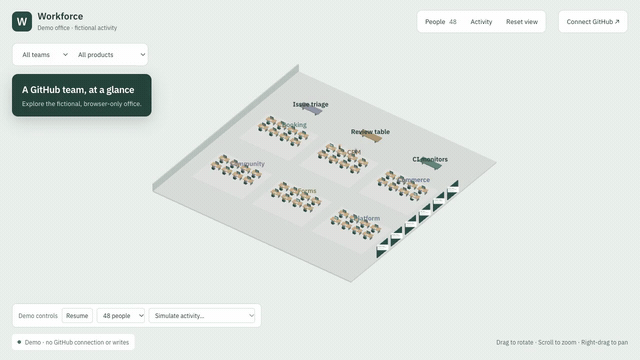

# Workforce — a read-only 3D GitHub office

A local, full-screen office with team desks, moving employees, product boards and
GitHub contribution details. GitHub is a **read-only source**: Workforce cannot push
code, edit issues, submit reviews, merge PRs or change repository settings.

## Watch the demo

[](docs/workforce-demo.mp4?raw=1)

[Watch the 28-second video](docs/workforce-demo.mp4?raw=1) showing simulated activity,
the contribution feed, teammate search, product boards and the 150-person view.
The recording uses the fictional browser-only demo; no GitHub account is needed.

## Run the demo

Requires Node 22+ and pnpm 10. No database, Redis, GitHub account, token or tunnel is
needed for the demo.

```bash
pnpm install
pnpm demo
```

Open **http://localhost:3000/office**. The default office is explicitly labeled
**Demo** and uses fictional employees and repositories. Demo data lives only in
browser memory; it is never written into the connected database or GitHub.

- Switch between 48 and 150 people, pause automatic events, or simulate an activity.
- Search for a person to focus their desk. Filter by team or product.
- Review activity moves employees to the review table; CI failures and issues use
  their shared stations. Activity expires and employees return to their desks.
- Merges and releases produce a brief reaction for new events only.
- Click a product board for its PR/review/CI summary and contribution history.
- Pan, rotate and zoom the office. Reset restores the overview.
- People and Activity panels provide keyboard access to the same information.
- Reduced motion disables movement; hidden tabs stop scene rendering. A WebGL
  failure exposes the people panel. Repeated furniture is instanced, and slow
  rendering lowers pixel density.

GitHub contribution activity is not evidence of attendance or continuous typing.
No productivity ranking, keystroke collection or attendance inference is included.

## Connect a GitHub organization

The local setup can connect to a GitHub organization. Demo and connected offices are
separate routes:

- `/office`: fictional demo, no backend requests.
- `/office?source=github`: authenticated, cached GitHub data; never falls back to demo
  data if the connection fails.

1. Start your locally installed PostgreSQL and Redis. Configure `DATABASE_URL` and
   `REDIS_URL` in `apps/server/.env`; the configured database must exist.
2. Create a private GitHub App under your organization. Grant read-only repository
   **Metadata, Contents, Pull requests, Issues, Actions**, and organization
   **Members** access (for members and teams). Disable webhooks for local polling.
3. Install it on only the repositories intended to be visible to everyone in this
   internal office. Generate a private key and configure:

   ```dotenv
   GITHUB_ORG=your-organization-slug
   BOOTSTRAP_ADMIN_LOGINS=your-github-username
   GITHUB_APP_ID=your-app-id
   GITHUB_APP_PRIVATE_KEY_PATH=/absolute/path/to/downloaded-private-key.pem
   GITHUB_POLL_ENABLED=true
   DEV_AUTH=true
   ```

4. Run:

   ```bash
   pnpm local:doctor
   pnpm local:setup
   pnpm dev
   ```

5. Open **Connect GitHub → Open connected office**, sign in locally as the configured
   administrator,
   then choose **Office setup → Sync GitHub installation**. Sync imports members,
   teams and repositories, and creates product boards. Existing employee mappings
   and locally assigned teams are preserved. A member of multiple GitHub teams
   initially uses the first team in slug order; local setup can change that.
6. Polling starts automatically. Each repository displays its last successful
   poll or error in Office setup. You can group multiple repositories under one
   product and import more history from the same setup window.

Never commit private keys or `.env`. The GitHub App uses an authentication POST to
mint an installation token; all repository and organization requests are GETs.
A runtime guard rejects other GitHub write requests. The app **does** write its own
local cache, seating, configuration, sessions and event history; those writes do
not modify GitHub.

For real GitHub sign-in, configure a separate OAuth App with callback
`http://localhost:3000/api/auth/github/callback`, set `GITHUB_OAUTH_CLIENT_ID` and
`GITHUB_OAUTH_CLIENT_SECRET`, and disable development sign-in. Development sign-in
is refused when `NODE_ENV=production`.

## Polling and reliability

The worker queues one deduplicated poll per connected repository each minute.
This is a scheduling interval, not guaranteed freshness: repository count and API
rate limits affect completion. First sync imports a baseline without animations;
later polls overlap the last successful checkpoint by two minutes. Failure keeps
the checkpoint unchanged and records an error. Jobs retry with backoff.

Polling reads PR snapshots, reviews, review comments, completed workflows, issues,
releases and pushes available from GitHub's repository event stream. That stream
is bounded and delayed by GitHub, so polling cannot recover every historic push.
Workflow recovery scans a rolling 30-day creation window. Long-running outages or
older CI reruns may require an explicit history import. Changes without a known
actor are not attributed to an arbitrary employee.

Optional signed webhooks provide faster updates at `/webhooks/github`. Enable
webhooks on the App and configure `GITHUB_WEBHOOK_SECRET` when an externally
reachable endpoint is available. No public domain is required for polling.

Events have semantic dedupe keys. Projections and an ordered transactional outbox
are committed together. The browser buffers socket traffic while installing a
consistent snapshot, deduplicates replay, and never celebrates replayed events.
Repository installation access is reconciled every five minutes.

## Tests and builds

```bash
pnpm test:local   # isolated embedded PostgreSQL + fictional data; no services needed
pnpm typecheck
pnpm build
```

The local suite covers migrations, ingestion ordering/deduplication, seat persistence,
product totals, mocked organization sync, GitHub write rejection, polling provenance,
demo data, team layout and replay suppression. Browser checks cover desktop/mobile,
search, selection, product panels, reduced motion and 150-person rendering.

`pnpm test` also includes the original HTTP/WebSocket integration suite, which needs
PostgreSQL (`TEST_DATABASE_URL`), Redis and permission to open a local port. Run
migrations on that test database first. Do not use the production database for tests.

Real organization credentials and a live organization synchronization have not been
used during development. A browser benchmark is not a guarantee of performance on
every integrated GPU. Verify both on the intended machine when connecting real data.

## Structure and deployment

- `apps/web`: Next.js, React Three Fiber/Three.js, Zustand and TanStack Query.
- `apps/server`: NestJS API and workers, PostgreSQL/Drizzle, BullMQ and Redis.
- `packages/contracts`: shared Zod data contracts.

`pnpm local:setup` applies migrations and prepares the local administrator without
seeding fictional employees. Existing data is preserved. When deploying, run
migrations before starting the updated API and worker. `ROLE=api|worker|all` selects
process responsibilities. `docker compose up --build` provides the full stack; use
root environment variables for Compose rather than `apps/server/.env`.

For hosted use, serve `/api`, `/webhooks` and `/rt` from the API and everything else
from the web app under one HTTPS origin. Configure `WEB_ORIGIN`, build-time `API_URL`
and `NEXT_PUBLIC_RT_URL` accordingly. The former v1 dashboard URLs redirect to the
office; the Pixi renderer and old dashboard navigation are no longer used.
# 3D-github-workforce
